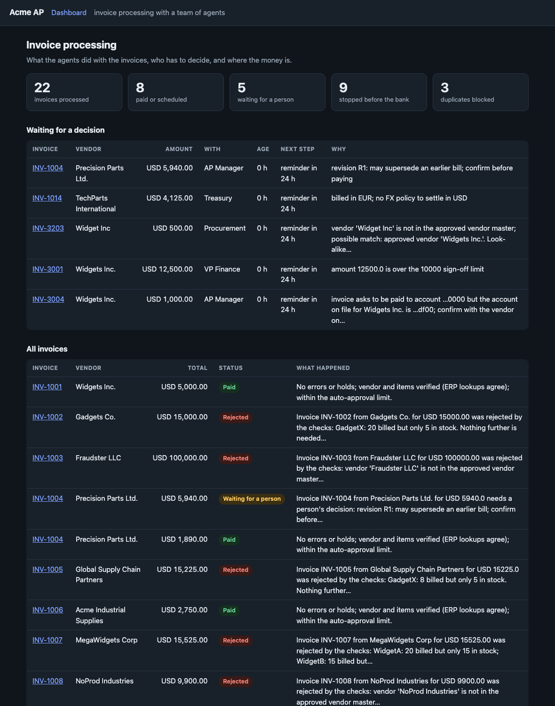
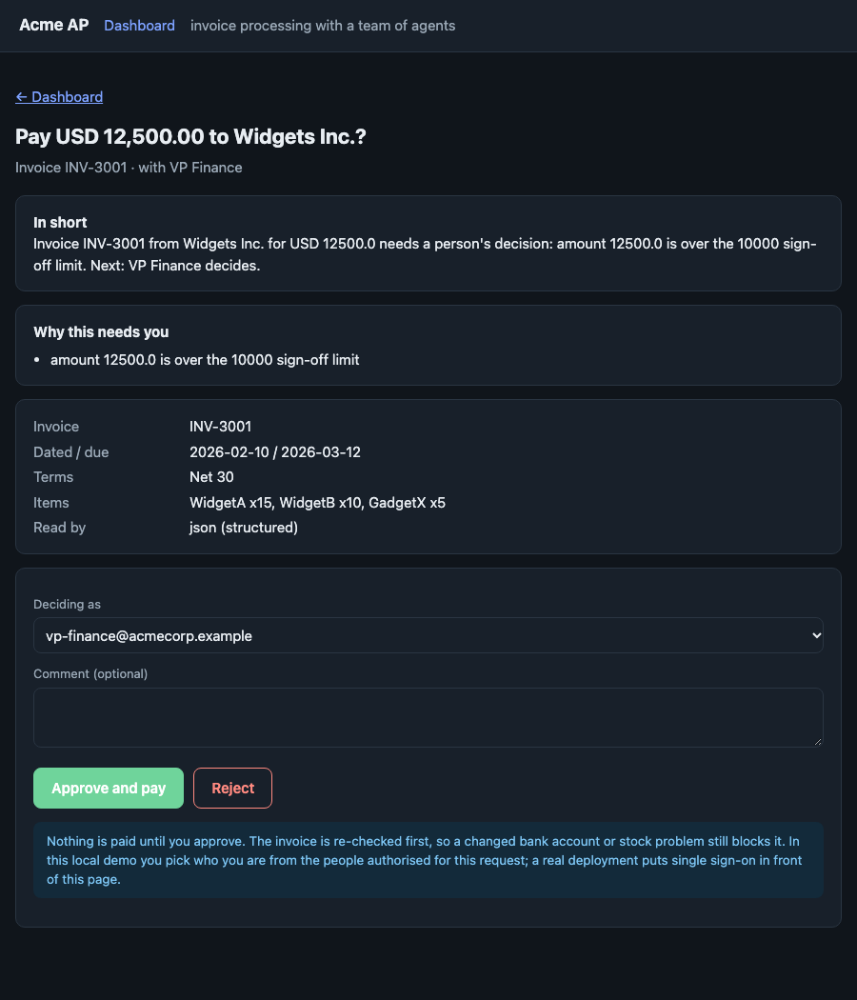
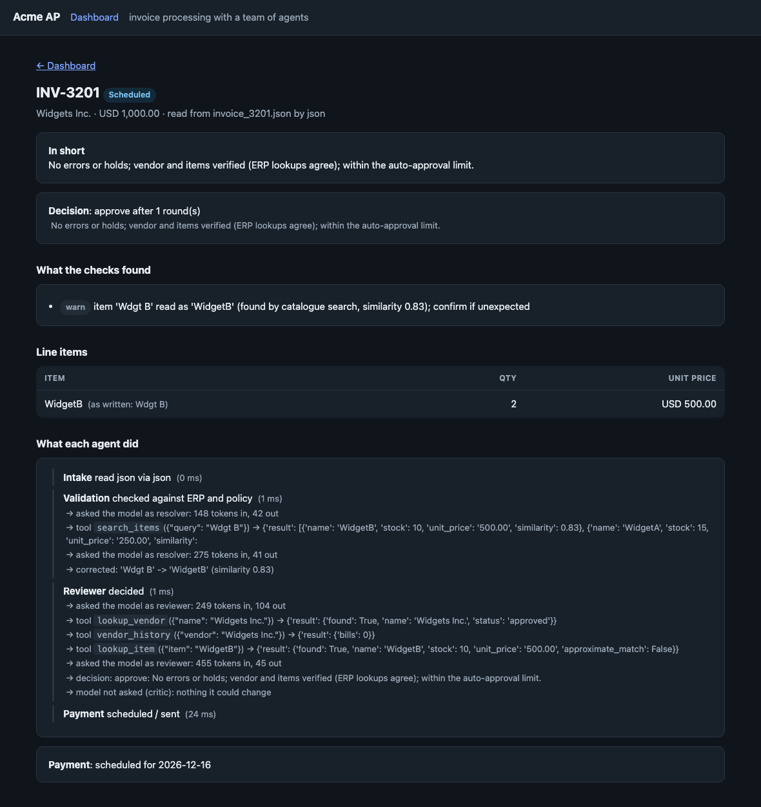

# Acme AP: invoice processing with a team of agents

Acme Corp loses about **$2M a year** to manual invoice processing: a 30% error rate, five-day delays, frustrated stakeholders. This is a working prototype that
reads invoices in any format, checks them against the ERP, gets the right person's decision where one is needed, pays on the due date, and tells everyone what
happened. Six agents with distinct jobs; Grok does the reasoning where reasoning helps, and plain rules do the work where a mistake costs money. Built for the case in
[docs/ASSIGNMENT.md](docs/ASSIGNMENT.md).

<p align="center"></p>

<table><tr>
<td width="50%"><br><sub><b>The approver's page.</b> One screen: the plain-English summary, why it needs you, one click. The invoice is re-checked before any money moves.</sub></td>
<td width="50%"><br><sub><b>What each agent did.</b> Here a mistyped item (<code>Wdgt B</code>) is found by a catalogue search tool, corrected, re-validated, and paid.</sub></td>
</tr></table>

The command line is first-class too: [`docs/img/demo.svg`](docs/img/demo.svg) is the real output of `python main.py demo`.

## Results

| What | Result | Evidence |
|---|---|---|
| The 17 provided invoices | **17 / 17 end as labelled**, 0 wrongly paid: 7 paid, 8 rejected, 2 sent to a person, 3 duplicates blocked | `make e2e`, `scripts/measure_quality.py` |
| Same run on **live Grok** | 17 / 17, 0 errors, 28 model calls, **$0.064 total (about $0.004 per invoice)** as reported by xAI | [`docs/live_runs/`](docs/live_runs/) (recorded transcript and JSON) |
| Errors caught before payment | stock shortfalls, unknown items, arithmetic that doesn't add up, a fraud pattern, a changed bank account, duplicates across formats | `data/invoices`, `tests/test_brief.py` |
| Robustness to garbage | 2,000 randomly corrupted invoices: **0 approved with a wrong value** (a stray "see invoice 31337" once got through; found and fixed) | `scripts/stress_extraction.py` |
| Speed | a clean invoice spends about 10-15 ms in the system, against "5 days" in the brief; about 2,200 documents/s on 14 cores | `main.py --bench`, [docs/ARCHITECTURE.md](docs/ARCHITECTURE.md) §4 |
| Waiting on a person | never silent: reminder at 24 h, escalation at 48 h, expiry at 5 days | `approve.py tick`, `make e2e` |
| Tests | **189 tests** plus a **47-check end-to-end run** from a fresh clone; a test fails the build if a credential is ever committed | `make test`, `make e2e` |

The pain points, one by one: **errors** are caught by exact checks and an independent second reading, not by trusting one model; **delays** shrink to milliseconds for
clean invoices and to a bounded clock for the ones that need a person; **frustrated stakeholders** get a one-question email at most, a remittance notice when paid,
a plain-English summary on every decision, and an AP digest of what is stuck and why.

## Cost and ROI

| | |
|---|---|
| **Model cost (measured)** | live Grok, 17 invoices: **$0.0637**, so about **$0.0037 per invoice**, roughly **$375 a year at 100,000 invoices**. Free by default: the local stand-in model costs nothing, and real Grok is opt-in with a hard per-run budget. |
| **Why it is cheap** | the model is only asked where it can change the result: never on rejects or anything already with a person (it can only tighten), once before each payment, and in extraction only when the rules' reading is incomplete. Asking about everything would be ~2.5x the calls and ~2.7x the tokens (`scripts/measure_llm_cost.py`). |
| **Savings (your numbers)** | `python scripts/roi.py` takes your volume, minutes per invoice, hourly cost and cost of an error. With *placeholder* inputs (100,000 invoices, 12 min each, $45/h, 30% errors at $60) today's cost comes out in the millions, the same order as the brief's $2M; those inputs are assumptions, not Acme's figures, and the script says so. Only the cost side is measured. |

## How it works

```
document -> INTAKE -> VALIDATION -> REVIEWER --approve--> PAYMENT -> COMMS
 (any format)   |          |  (resolver)    |  \--escalate--> DESK (a person decides) --approve--> PAYMENT
                |          |                \--reject---------------------------------------------> COMMS
```

| Agent | Job | Uses the model? |
|---|---|---|
| **Intake** | any document (PDF, scan, email, JSON/XML/UBL/CSV, text) into a structured invoice | only when the rules' reading is in doubt; answer cross-checked field by field |
| **Validation** | vendor, items, stock, arithmetic, dates, fraud signals, bank account; a *resolver* searches for mistyped item names and re-checks | rules; a model-driven search loop only for names it cannot match |
| **Reviewer** | approve / escalate / reject; a model with read-only tools gives a second opinion, a challenger audits it | yes, before every payment |
| **Desk** | the human in the loop: right approver, signed one-click link, reminders, escalation | **never** |
| **Payment** | schedule to the due date or capture a discount, verify the payee account, send idempotently, reconcile | **never** |
| **Comms** | vendor questions, plain-English notes, remittance notices, the AP digest | to phrase only; checked against the record |

**Why some agents use no model.** Moving money and asking people to approve it are the two places where a plausible-sounding mistake is expensive and an exact rule is
cheap. So the design is *the model proposes, the rules dispose*: a model can make a decision stricter, never looser (a hallucinated "approve" cannot release money); it
never touches payments, routing or bank details; and text it writes is discarded for a template if it adds a figure, drops a required figure, or contains a link. This is
tested with hostile inputs, not just asserted: a model that obeys every injected instruction, one that returns garbage, and one that is down all leave the 17 outcomes unchanged.

### What the model actually does (the agentic part)

| Capability | Where | Proof |
|---|---|---|
| **Function calling** | the reviewer's model calls `lookup_item`, `lookup_vendor`, `vendor_history`, `policy_limits`; the resolver calls `search_items`, `search_vendors`; bad calls come back as errors it can correct from | `tests/test_tooluse.py`, `scripts/live_smoke.py` (live), `docs/live_runs/` |
| **Native structured output** | replies must fit a Pydantic schema, sent to the API as strict **JSON Schema** (stepping down to JSON-object mode, then plain, only if an endpoint refuses); JSON is parsed, never grepped | `tests/test_tooluse.py`, live-verified |
| **Self-correction loops** | arithmetic self-check and retry; a malformed reply is returned to the model with the reason; the auditor challenges the reviewer's draft; **tool-driven item correction** re-validates the invoice after a fix; the always-on draft-critique-revise reflection | `tests/test_agent_upgrades.py`, `tests/test_brief.py` |
| **Guards on the model** | item fixes only if the pick exists *and* is textually close (a model that wants `SuperGizmo` to become `WidgetA` is refused); vendor names are never auto-corrected, only flagged (look-alike vendors are a classic fraud) | `tests/test_agent_upgrades.py` |
| **Visible reasoning** | every invoice records which agent did what, which tools the model called and what it concluded: `--trace`, the web page, `--json` | screenshot above |

Honest limits: Grok tends to agree with the rules on the provided invoices (they are mostly clear-cut), so on these samples the model rarely changes an outcome; the
self-correction samples in `data/self_correction/` are where it visibly does. The local stand-in model is deterministic rules wearing the same protocol, and says so
wherever it appears.

## Run it

```bash
python3 -m venv .venv && .venv/bin/pip install -r requirements.txt      # set up (Tesseract only for scanned PDFs)
.venv/bin/python main.py --invoice_path=data/invoices                   # process the sample invoices (free, offline)
.venv/bin/python main.py serve --demo                                   # the web interface at http://127.0.0.1:8765 (loads a worked example); after a normal run: `main.py serve`, and the approval links in the cards open there
.venv/bin/python main.py demo                                           # the whole story in one command
.venv/bin/python main.py --trace --invoice_path=data/self_correction    # watch the agents work
.venv/bin/python main.py --grok --invoice_path=data/invoices            # real Grok: billed per token, capped per run (see below)
make test        make e2e        make ui
```

**Cost safety.** Everything above except `--grok` is free. `--grok` (or `ACME_USE_GROK=1`) uses the real xAI API, billed per token; it needs `XAI_API_KEY` or a key saved
alone in `~/.config/acme_ap/xai_key` (`chmod 600`), and never runs just because a key exists. Each run stops asking the model at `XAI_BUDGET_USD` (default $0.25) and
the report shows the exact amount xAI says it charged. The key is never written to the repo, logs or outputs; `tests/test_no_secrets.py` fails the build if one is committed.

More: `approve.py` and `pay.py` (approver and treasury command lines), `main.py agents` (the roster), `--bench 20000`, `scripts/measure_quality.py`, `scripts/stress_extraction.py`.

## The brief's evaluation criteria

| Criterion | Where to look |
|---|---|
| **Functionality** | 17/17 end to end, offline and on live Grok; `make e2e` (47 checks from a fresh clone) |
| **Code quality** | typed models, one responsibility per module, error handling at every boundary (a failing model step never fails an invoice), structured logs, 189 tests |
| **Agentic sophistication** | the table above: tool use, strict structured output, five self-correction loops, six agents with charters, guards, recorded live runs |
| **Shipping mindset** | simulated what must be (bank, ERP, email) behind adapters; cut what doesn't earn its keep (no framework, no database server, no auth system); limits stated in §5 of the architecture doc |
| **Presentation** | this page; measured results with evidence; cost and ROI; screenshots from a real run |
| **Above and beyond** | email and e-invoice intake, OCR, signed one-click approvals with escalation, scheduled payments with discounts and bank holidays, bank-account fraud check with dual control, reconciliation, adversarial and stress tests, a cost guard |
| **UI/UX** | the web interface (dashboard, approval page, per-invoice agent trace), a guided demo, readable CLI output, links that actually open |

## Where things live

| Path | Responsibility |
|---|---|
| `main.py` | command line: a batch, `demo`, `serve`, `agents`, `--bench` |
| `acme_ap/web.py`, `store.py` | the web interface (standard library only) and the record it reads |
| `acme_ap/agents/` | `team.py` (the six agents), `validation`, `resolver`, `approval`, `comms`, `tools` |
| `acme_ap/pipeline.py` | the flow per invoice through the agents; CPU and I/O scheduling |
| `acme_ap/llm.py`, `sim_llm.py` | Grok client (tools, schema output, retries, cache, budget) and the local stand-in |
| `acme_ap/ingestion/` | any file into an `Invoice`: PDF/OCR, JSON/XML/UBL/CSV, regex and Grok extraction |
| `acme_ap/approvals/`, `payments/`, `erp/` | routing and signed links; scheduling, bank adapter, reconciliation; the ERP interface and its SQLite mock |
| `data/`, `scripts/`, `tests/` | provided and added samples; benchmarks, screenshots, ROI; the tests |

## Limits worth knowing

The bank, ERP and email are simulated behind adapters; no email is sent. The web interface lets you pick who is deciding from the people the routing table authorises for that
request, which stands in for single sign-on that a real deployment must put in front. Grok's accuracy on messy scans is unmeasured. Details and the full list:
[docs/ARCHITECTURE.md](docs/ARCHITECTURE.md) (ERP choice, vendor strategy, CPU design, approval and payment design, hardening, live verification, limits) and
[docs/live_runs/](docs/live_runs/).
