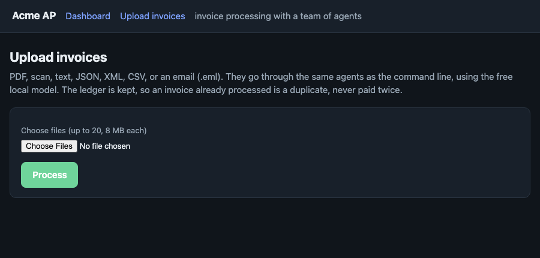

# Acme AP: invoice processing with a team of agents

Acme Corp loses about **$2M a year** to manual invoice processing: a 30% error rate, five-day delays, frustrated stakeholders. This is a working prototype that
reads invoices in any format, checks them against the ERP, gets the right person's decision where one is needed, pays on the due date, and tells everyone what
happened. Six agents with distinct jobs; Grok does the reasoning where reasoning helps, and plain rules do the work where a mistake costs money. Built for the case in
[docs/ASSIGNMENT.md](docs/ASSIGNMENT.md).

<p align="center"></p>

<table><tr>
<td width="50%"><br><sub><b>The approver's page.</b> One screen: the plain-English summary, why it needs you, one click. The invoice is re-checked before any money moves.</sub></td>
<td width="50%"><br><sub><b>What each agent did.</b> Here a mistyped item (<code>Wdgt B</code>) is found by a catalogue search tool, corrected, re-validated, and paid.</sub></td>
</tr></table>

<p align="center"><br><sub><b>Upload.</b> Drop PDFs, text, JSON/XML/CSV or emails; they go through the same agents and the same ledger as the command line.</sub></p>

The command line is first-class too: [`docs/img/demo.svg`](docs/img/demo.svg) is the real output of `python main.py demo`.

## Results

| What | Result | Evidence |
|---|---|---|
| The 17 provided invoices | **17 / 17 end as labelled**, 8 / 8 on the outcomes the brief itself states, 0 wrongly paid: 7 paid, 8 rejected, 2 sent to a person, 3 duplicates blocked | **[docs/EVALUATION.md](docs/EVALUATION.md)**: every invoice, decision and reason, rules-only and LLM-on reported separately |
| Same run on **live Grok** | 17 / 17, 0 errors, 36 model calls and 42 tool calls, **$0.020 total (about $0.0012 per invoice)** as reported by xAI | [`docs/live_runs/`](docs/live_runs/): recorded transcript, JSON, and a **recording you can replay offline for free** (`--replay-llm`) |
| Errors caught before payment | stock shortfalls, unknown items, arithmetic that doesn't add up, a fraud pattern, a changed bank account, duplicates across formats | `data/invoices`, `tests/test_brief.py` |
| Robustness to garbage | 2,000 randomly corrupted invoices: **0 approved with a wrong value** (a stray "see invoice 31337" once got through; found and fixed) | `scripts/stress_extraction.py` |
| Speed | a clean invoice spends about 10-15 ms in the system, against "5 days" in the brief; about 2,200 documents/s on 14 cores | `main.py --bench`, [docs/ARCHITECTURE.md](docs/ARCHITECTURE.md) §4 |
| Waiting on a person | never silent: reminder at 24 h, escalation at 48 h, expiry at 5 days | `approve.py tick`, `make e2e` |
| Tests | **248 tests** plus a **56-check end-to-end run** from a fresh clone; a test fails the build if a credential is ever committed | `make test`, `make e2e` |

## Business impact

| | Before (from the brief) | Now | How we know |
|---|---|---|---|
| **Error rate** | 30% of invoices | on the provided set, all 10 problem invoices were stopped or sent to a person before any money moved, **0 wrong payments** (the brief itself names 5 of them: a stock mismatch, out-of-stock/fraud, two unknown items, invalid data) | `docs/EVALUATION.md`; 2,000-invoice stress test |
| **Time per invoice** | 5 days | clean invoices: milliseconds, no human. Invoices needing a person: a prepared one-click card, with a clock that reminds at 24 h and escalates at 48 h | `main.py` impact block, `approve.py tick` |
| **Cost per invoice (model)** | n/a | **about $0.0012** measured live, roughly **$118 a year at 100,000 invoices**; free by default | `docs/live_runs/`, `scripts/roi.py` |
| **People's time** | 12 min of keying and chasing (assumed) | only the invoices that need a decision, and those arrive summarised | `scripts/roi.py` (your inputs) |

The savings side depends on Acme's volume and wages, which the brief does not give, so `python scripts/roi.py` takes your numbers and shows the structure and a sensitivity table. With *placeholder*
inputs (100,000 invoices, 12 min each, $45/h, 30% errors at $60) today's cost comes out in the millions, the same order as the brief's $2M. Those inputs are assumptions, not Acme's figures; only
the cost side is measured.

## Design decisions

1. **The model proposes, the rules dispose.** A model can make a decision stricter, never looser; it never touches payments, routing or bank details; text it writes is checked against the
   record. *Trade-off:* on clear-cut invoices the model rarely changes an outcome (see EVALUATION.md); its value is second opinions, plain-English notes, reading messy documents and fixing mistyped names.
2. **Ask the model only where it can matter.** Never on rejects or anything already with a person; once before each payment; in extraction only when the rules' reading is incomplete. *Trade-off:* a cheaper,
   safer system that looks less "AI-heavy"; asking about everything is ~2.5x the calls (`scripts/measure_llm_cost.py`).
3. **A custom orchestrator, not LangGraph/CrewAI.** CPU-bound PDF work and I/O-bound model and bank calls need different scheduling, and six agents with charters did not need a framework. *Trade-off:* more code of our own.
4. **Free by default, live on request, capped.** A local stand-in model (labelled as such) runs the same protocol; `--grok` is opt-in with a per-run budget; the default model is a plain one, not a reasoning one, because a
   reasoning model was ~3x the cost and several times slower for this work (measured).
5. **The ledger is the system's memory and it is kept between runs**, so nothing is ever paid twice, with idempotency keys on every payment. Duplicates use the vendor's master name; a changed resubmission of a rejected invoice is allowed.
6. **Stock is a per-invoice cap by default** (the brief's own table lists three invoices as "within stock" that together exceed it); `--stock-policy reserve` is the cumulative, opt-in alternative.
7. **Payments are scheduled, not instant**: due date minus bank lead time (business days), early-pay discounts captured, an account on the invoice that differs from the one on file is held, new accounts need two people.
8. **Approvals are signed links issued to one mailbox**, single-use, expiring, bound to the invoice as shown, with the signing key outside the database. *Trade-off:* a forwarded link acts as its addressee; real use needs email delivery and SSO.
9. **A small web interface on the standard library, not Streamlit**: upload, dashboard, review queue and the approval page in one dependency-free server (hardened for the endpoints that can pay). *Trade-off:* less polish than a UI toolkit.
10. **Evidence over claims**: live runs are recorded and replayable, the evaluation reports rules-only and LLM-on separately, and labels written by the developer are kept apart from the brief's own.

## How it works

```
document -> INTAKE -> VALIDATION -> REVIEWER --approve--> PAYMENT -> COMMS
 (any format)   |          |  (resolver)    |  \--escalate--> DESK (a person decides) --approve--> PAYMENT
                |          |                \--reject---------------------------------------------> COMMS
```

| Agent | Job | Uses the model? |
|---|---|---|
| **Intake** | any document (PDF, scan, email, JSON/XML/UBL/CSV, text) into a structured invoice | only when the rules' reading is in doubt; answer cross-checked field by field |
| **Validation** | vendor, items, stock, arithmetic, dates, fraud signals, bank account; a *resolver* searches for mistyped item names and re-checks | rules; a model-driven search loop only for names it cannot match |
| **Reviewer** | approve / escalate / reject; a model with read-only tools gives a second opinion, a challenger audits it | yes, before every payment |
| **Desk** | the human in the loop: right approver, signed one-click link, reminders, escalation | **never** |
| **Payment** | schedule to the due date or capture a discount, verify the payee account, send idempotently, reconcile | **never** |
| **Comms** | vendor questions, plain-English notes, remittance notices, the AP digest | to phrase only; checked against the record |

### What the model actually does (the agentic part)

| Capability | Where | Proof |
|---|---|---|
| **Function calling** | the reviewer's model calls `lookup_item`, `lookup_vendor`, `vendor_history`, `policy_limits`; the resolver calls `search_items`, `search_vendors`; bad calls come back as errors it can correct from | `tests/test_tooluse.py`, `scripts/live_smoke.py`, 42 live tool calls in `docs/live_runs/` |
| **Native structured output** | replies must fit a Pydantic schema, sent to the API as strict **JSON Schema** (stepping down to JSON-object mode, then plain, only if an endpoint refuses); JSON is parsed, never grepped | `tests/test_tooluse.py`, live-verified |
| **Self-correction loops** | arithmetic self-check and retry; a malformed reply is returned to the model with the reason; the auditor challenges the reviewer's draft; **tool-driven item correction** re-validates after a fix; the always-on draft-critique-revise reflection | `tests/test_agent_upgrades.py`, `tests/test_brief.py` |
| **Guards on the model** | item fixes only if the pick exists *and* is textually close; vendor names are never auto-corrected, only flagged (look-alike vendors are a classic fraud) | `tests/test_agent_upgrades.py` |
| **Visible reasoning** | every invoice records which agent did what, which tools the model called and what it concluded | `--trace`, the web page, `--json` |

## Run it

```bash
python3 -m venv .venv && .venv/bin/pip install -r requirements.txt      # set up (Tesseract only for scanned PDFs)
.venv/bin/python main.py --invoice_path=data/invoices                   # process the sample invoices (free, offline)
.venv/bin/python main.py --invoice_path=data/invoices --reset           # run again from an empty ledger (without --reset the ledger is kept: nothing is ever paid twice)
.venv/bin/python main.py serve --demo                                   # the web interface: dashboard, upload, review queue (http://127.0.0.1:8765)
.venv/bin/python main.py demo                                           # the whole story in one command
.venv/bin/python main.py --replay-llm docs/live_runs/provided-invoices.cassette.jsonl --invoice_path=data/invoices   # a real Grok run, replayed offline for free
.venv/bin/python main.py --trace --invoice_path=data/self_correction    # watch the agents work
.venv/bin/python main.py --grok --invoice_path=data/invoices            # real Grok: billed per token, capped per run
make test        make e2e        make ui
```

**Cost safety.** Everything above except `--grok` and `--record-llm` is free. They use the real xAI API, billed per token; they need `XAI_API_KEY` or a key saved alone in
`~/.config/acme_ap/xai_key` (`chmod 600`), and a key never gets used just because it exists. Each run stops asking the model at `XAI_BUDGET_USD` (default $0.25) and the report shows the exact
amount xAI says it charged. The key is never written to the repo, logs or outputs; `tests/test_no_secrets.py` fails the build if one is committed.

More: `approve.py` and `pay.py` (approver and treasury command lines), `main.py agents` (the roster), `--bench 20000`, `scripts/evaluate.py`, `scripts/measure_quality.py`, `scripts/stress_extraction.py`.

## The brief's evaluation criteria

| Criterion | Where to look |
|---|---|
| **Functionality** | 17/17 end to end, offline and on live Grok; `make e2e` (56 checks from a fresh clone) |
| **Code quality** | typed models, one responsibility per module, error handling at every boundary (a failing model step never fails an invoice), structured logs, 248 tests |
| **Agentic sophistication** | the table above: tool use, strict structured output, five self-correction loops, six agents with charters, guards; recorded, replayable live runs and a per-invoice evaluation |
| **Shipping mindset** | simulated what must be (bank, ERP, email) behind adapters; cut what doesn't earn its keep (no framework, no database server, no auth system); limits stated in §5 of the architecture doc |
| **Presentation** | this page; measured results with evidence; business impact, cost and ROI; design decisions; screenshots from a real run |
| **Above and beyond** | email and e-invoice intake, OCR, signed one-click approvals with escalation, scheduled payments with discounts and bank holidays, bank-account fraud check with dual control, reconciliation, adversarial and stress tests, a cost guard, record/replay |
| **UI/UX** | the web interface (dashboard, **upload**, review queue, approval page, per-invoice agent trace), a guided demo, readable CLI output, links that actually open |

## Where things live

| Path | Responsibility |
|---|---|
| `main.py` | command line: a batch, `demo`, `serve`, `agents`, `--bench`, `--record-llm` / `--replay-llm` |
| `acme_ap/web.py`, `store.py` | the web interface (standard library only) and the record it reads |
| `acme_ap/agents/` | `team.py` (the six agents), `validation`, `resolver`, `approval`, `comms`, `tools` |
| `acme_ap/pipeline.py` | the flow per invoice through the agents; CPU and I/O scheduling |
| `acme_ap/llm.py`, `cassette.py`, `sim_llm.py` | Grok client (tools, schema output, retries, cache, budget), record/replay, and the local stand-in |
| `acme_ap/ingestion/` | any file into an `Invoice`: PDF/OCR, JSON/XML/UBL/CSV, regex and Grok extraction |
| `acme_ap/approvals/`, `payments/`, `erp/` | routing and signed links; scheduling, bank adapter, reconciliation; the ERP interface and its SQLite mock |
| `data/`, `scripts/`, `tests/` | provided and added samples; benchmarks, evaluation, screenshots, ROI; the tests |

## Limits worth knowing

The bank, ERP and email are simulated behind adapters; no email is sent. A decision link is issued to one approver's mailbox and whoever holds it acts as that person; a real deployment must deliver it by email
and put single sign-on in front of the page. Stock is checked per invoice by default (the brief's own sample table requires that). On the provided invoices Grok agrees with the rules, so the evaluation shows
what the model adds (second opinions, notes, emails) rather than different decisions; where it changes outcomes is `data/self_correction/`, which is the developer's own sample set. Grok's accuracy on messy scans is
unmeasured. Not tested on Windows itself. Details: [docs/ARCHITECTURE.md](docs/ARCHITECTURE.md) (ERP choice, vendor strategy, CPU design, approval and payment design, hardening, live verification, review fixes, limits).
